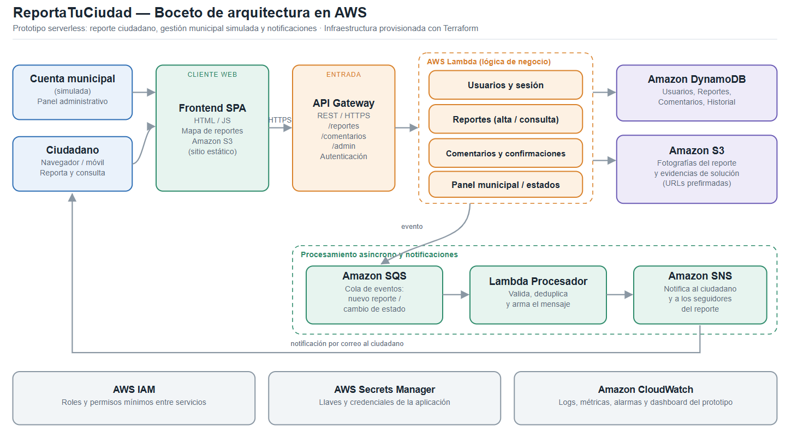

# ReportaTuCiudad

Plataforma web que conecta a los ciudadanos con una **cuenta oficial municipal simulada** para reportar, dar seguimiento y cerrar problemas urbanos: baches, luminarias dañadas, acumulación de basura, fugas de agua, árboles caídos o semáforos fuera de servicio.

Un ciudadano crea su cuenta, levanta un reporte con descripción, fotografía y ubicación, y lo ve publicado en un mapa junto con los demás reportes de su zona. Otros usuarios pueden confirmar que también observaron el problema y comentar en él, lo que evita reportes duplicados y muestra qué incidencias afectan a más personas. La cuenta municipal atiende los reportes desde un panel administrativo, cambia su estado, responde y publica la evidencia de la solución; el ciudadano recibe una notificación por correo y confirma si el problema realmente quedó resuelto.

El objetivo no es construir un sistema gubernamental real, sino un **prototipo funcional** que simule el ciclo completo de comunicación entre ciudadanía e institución municipal sobre una arquitectura serverless en AWS, levantada por completo con Terraform.

> **Estado:** Fase 3 — aplicación completa en AWS, con capa comunitaria, pruebas unitarias,
> CI/CD con despliegue automático y monitoreo con métricas propias.

## Estados de un reporte

`Reportado` → `En revisión` → `Asignado` → `En proceso` → `Resuelto`

Si al cerrarse dos o más ciudadanos indican que el problema continúa, el reporte vuelve automáticamente a `En revisión`.

## Flujos end to end implementados

1. **Levantar un reporte ciudadano.** Registro/inicio de sesión, formulario con categoría, descripción y ubicación en el mapa, foto subida directo a S3 con URL prefirmada, guardado en DynamoDB y publicación en el mapa público con su folio.
2. **Gestión y cambio de estado por la cuenta municipal.** Bandeja ordenada por número de confirmaciones, cambio de estado, respuesta al ciudadano, evidencia obligatoria para cerrar e historial completo del reporte.
3. **Participación comunitaria y confirmación del cierre.** Confirmaciones "yo también lo vi" sin duplicados, comentarios, notificación por correo en cada avance y validación final del ciudadano.

## Qué puede hacer la gente

**Como ciudadano:** levantar un reporte con foto y ubicación, ver en el mapa lo que pasa en su zona, confirmar que también vio un problema, comentar, seguir reportes ajenos para enterarse de su avance y validar si un cierre fue real. Tiene un perfil público con lo que ha aportado y seis insignias que se ganan participando, una campana con sus avisos, un muro con la actividad reciente de la ciudad y un tablero con los números de cuánto se reporta y cuánto se resuelve.

**Como cuenta municipal:** una bandeja ordenada por número de confirmaciones, para atender primero lo que afecta a más gente; cambio de estado con respuesta al ciudadano, historial completo y evidencia obligatoria para cerrar.

## Arquitectura



Diagrama interactivo: [`docs/arquitectura.html`](docs/arquitectura.html)

| Servicio | Uso en el proyecto |
|---|---|
| Amazon API Gateway (HTTP API) | Punto de entrada HTTPS de las 20 rutas del API |
| AWS Lambda | 6 funciones en Python 3.12: `auth`, `reportes`, `interacciones`, `admin`, `social` y `notificador` |
| Amazon DynamoDB | 5 tablas (`usuarios`, `reportes`, `interacciones`, `notificaciones`, `actividad`) con 3 índices secundarios |
| Amazon S3 | Fotografías y evidencias + hospedaje del sitio estático |
| Amazon SQS + Amazon SNS | Cola de eventos con DLQ y notificaciones por correo |

Servicios de soporte: **AWS IAM** (dos roles con permisos mínimos), **AWS Secrets Manager** (llave de firma de las sesiones) y **Amazon CloudWatch** (logs, seis métricas propias, diez alarmas y un dashboard).

## Puesta en marcha rápida

```bash
git clone https://github.com/luishdezc/ReportaTuCiudad.git
cd reportatuciudad

# 1. Credenciales de AWS
aws configure && aws sts get-caller-identity

# 2. Correos del equipo para las notificaciones
$EDITOR infra/envs/dev.tfvars

# 3. Desplegar infraestructura + aplicación
./scripts/deploy.sh dev

# 4. Sembrar la cuenta oficial municipal
./scripts/crear_cuenta_municipal.sh municipio@reportatuciudad.mx "Municipio2026!"

# 5. Probar los tres flujos end to end
./scripts/prueba_flujos.sh municipio@reportatuciudad.mx "Municipio2026!"

# 5 bis. (Opcional) Sembrar reportes de ejemplo para que el mapa no salga vacio
./scripts/sembrar_demo.sh municipio@reportatuciudad.mx "Municipio2026!"

# 6. Apagar el ambiente al terminar
./scripts/destroy.sh dev
```

`deploy.sh` imprime al final la URL del sitio, la del API y la del dashboard de CloudWatch.
Los pasos detallados, el estado remoto de Terraform y la solución de problemas frecuentes están en [`docs/DESPLIEGUE.md`](docs/DESPLIEGUE.md).

> Tras el primer `apply`, AWS envía un correo de confirmación de la suscripción a SNS. Hay que aceptarlo o no llegarán las notificaciones.

## Infraestructura como código

Todos los recursos se crean con Terraform; no se toca la consola de AWS.

```bash
cd infra
terraform init
terraform plan  -var-file=envs/dev.tfvars
terraform apply -var-file=envs/dev.tfvars
terraform destroy -var-file=envs/dev.tfvars
```

Los dos buckets de S3 son la única excepción: los crea `scripts/deploy.sh` con la CLI y Terraform administra toda su configuración. El motivo es que el recurso `aws_s3_bucket` consulta la configuración de Object Lock al leer su estado, y en cuentas de clase (AWS Academy Learner Lab) una SCP niega esa llamada y el `apply` falla.

**En el AWS Academy Learner Lab** usa el ambiente `lab`, que reutiliza el rol `LabRole` porque esa cuenta no permite crear roles de IAM:

```bash
./scripts/deploy.sh lab
```

El estado remoto se guarda en un bucket de S3 con bloqueo en DynamoDB, creado una sola vez desde `infra/bootstrap/`.
No se versionan archivos `.tfstate`, `.tfvars` con datos sensibles ni credenciales de AWS.

## Estructura del repositorio

```
backend/src/        Funciones Lambda (Python 3.12) y utilidades compartidas
backend/tests/      82 pruebas unitarias con pytest y moto
.github/workflows/  Pipelines de integración (ci.yml) y despliegue (deploy.yml)
frontend/           Sitio estático con Vue 3: mapa ciudadano, muro de la ciudad,
                    tablero público y panel municipal. Sistema visual propio y
                    sprite de 49 iconos en línea, sin CDN
infra/              Terraform: 14 archivos .tf, variables por ambiente (dev y lab) y bootstrap del estado
scripts/            deploy.sh, destroy.sh, limpiar_lab.sh, crear_cuenta_municipal.sh,
                    sembrar_demo.sh, prueba_flujos.sh
docs/               Arquitectura, guía de despliegue, contrato del API, modelo de datos y avance
```

## Documentación

| Documento | Contenido |
|---|---|
| [`docs/DESPLIEGUE.md`](docs/DESPLIEGUE.md) | Requisitos, estado remoto, despliegue paso a paso y problemas frecuentes |
| [`docs/API.md`](docs/API.md) | Las 20 rutas del API, cuerpos, códigos de error y eventos internos |
| [`docs/MODELO_DATOS.md`](docs/MODELO_DATOS.md) | Tablas, índices y por qué ese diseño |
| [`docs/CONTRIBUIR.md`](docs/CONTRIBUIR.md) | Ramas, convención de commits y reparto del trabajo |
| [`docs/MONITOREO.md`](docs/MONITOREO.md) | Las seis métricas, las diez alarmas y el dashboard |
| [`docs/DISENO.md`](docs/DISENO.md) | El sistema visual, el código de color por categoría y por qué no hay framework de CSS |
| [`docs/PRUEBAS.md`](docs/PRUEBAS.md) | Cómo correr las pruebas, qué cubren y el error que encontraron |
| [`docs/CICD.md`](docs/CICD.md) | Los dos pipelines, los secretos del despliegue y los Pull Requests de la Fase 3 |

## Pruebas y calidad

```bash
pip install -r backend/requirements-dev.txt
cd backend && pytest --cov=src        # 82 pruebas, 94 % de cobertura
ruff check backend/                    # linter
```

Cada Pull Request a `main` dispara el pipeline de integración: linter, pruebas con umbral de cobertura, validación de Terraform, sintaxis del frontend y los scripts, y una revisión de que no se suban credenciales.

Al integrar en `main`, el pipeline de despliegue repite las pruebas y, si pasan, aplica Terraform, publica el frontend y corre la prueba de humo de los tres flujos contra el ambiente real. El detalle está en [`docs/CICD.md`](docs/CICD.md).

## Frontend

Las dos interfaces usan **Vue 3** cargado desde CDN, sin paso de compilación: el sitio se publica tal cual como archivos estáticos en S3. El mapa (Leaflet) es el elemento principal de la vista ciudadana, los reportes se listan como fichas a un costado y el detalle abre en un panel lateral con el avance dibujado como una vía de cinco paradas. El panel municipal es una bandeja densa cuyo resumen por estado funciona como filtro.

El rail tiene tres pestañas: los reportes del mapa, el muro de actividad de la ciudad y el tablero de estadísticas. El perfil de cada ciudadano y la campana de avisos abren en paneles laterales.

El sistema visual está en `frontend/styles.css`: tinta azul de placa de calle, ámbar de obra en vía para lo que requiere atención, verde para lo resuelto. El folio del reporte es lo único en tipografía monoespaciada, porque es un número de expediente.

## Equipo

| Integrante | Rol |
|---|---|
| Carlos Olmedo | Arquitectura cloud, Terraform y monitoreo (IAM, Secrets Manager, SQS, SNS, CloudWatch) |
| Luis Hernandez | Backend, API y datos (Lambda, API Gateway, DynamoDB, S3) |
| Isaian Ayala | Frontend, pruebas y documentación (mapa ciudadano, panel municipal, repositorio) |

## Costos y buenas prácticas

El prototipo usa servicios de pago por uso y todo está en modo bajo demanda: con el tráfico de una demostración el costo es de centavos. Aun así, `./scripts/destroy.sh` elimina el ambiente completo cuando no se está trabajando.

## Aviso

Proyecto académico. La cuenta municipal es **simulada** y no representa a ninguna institución real.

## Video de prueba

En el siguiente video se muestra el funcionamiento de la app:

[Ver video de prueba](https://youtu.be/Yvr5PMDE6xI)