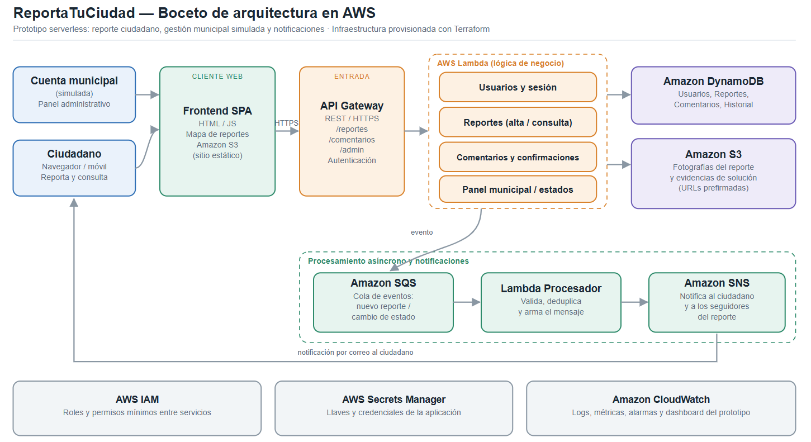

# ReportaTuCiudad

Plataforma web que conecta a los ciudadanos con una **cuenta oficial municipal simulada** para reportar, dar seguimiento y cerrar problemas urbanos: baches, luminarias dañadas, acumulación de basura, fugas de agua, árboles caídos o semáforos fuera de servicio.

Un ciudadano crea su cuenta, levanta un reporte con descripción, fotografía y ubicación, y lo ve publicado en un mapa junto con los demás reportes de su zona. Otros usuarios pueden confirmar que también observaron el problema y comentar en él, lo que evita reportes duplicados y muestra qué incidencias afectan a más personas. La cuenta municipal atiende los reportes desde un panel administrativo, cambia su estado, responde y publica la evidencia de la solución; el ciudadano recibe una notificación por correo y confirma si el problema realmente quedó resuelto.

El objetivo no es construir un sistema gubernamental real, sino un **prototipo funcional** que simule el ciclo completo de comunicación entre ciudadanía e institución municipal sobre una arquitectura serverless en AWS, levantada por completo con Terraform.

> **Estado:** Fase 2 — aplicación desplegada y funcionando en AWS.

## Estados de un reporte

`Reportado` → `En revisión` → `Asignado` → `En proceso` → `Resuelto`

Si al cerrarse dos o más ciudadanos indican que el problema continúa, el reporte vuelve automáticamente a `En revisión`.

## Flujos end to end implementados

1. **Levantar un reporte ciudadano.** Registro/inicio de sesión, formulario con categoría, descripción y ubicación en el mapa, foto subida directo a S3 con URL prefirmada, guardado en DynamoDB y publicación en el mapa público con su folio.
2. **Gestión y cambio de estado por la cuenta municipal.** Bandeja ordenada por número de confirmaciones, cambio de estado, respuesta al ciudadano, evidencia obligatoria para cerrar e historial completo del reporte.
3. **Participación comunitaria y confirmación del cierre.** Confirmaciones "yo también lo vi" sin duplicados, comentarios, notificación por correo en cada avance y validación final del ciudadano.

## Arquitectura



Diagrama interactivo: [`docs/arquitectura.html`](docs/arquitectura.html)

| Servicio | Uso en el proyecto |
|---|---|
| Amazon API Gateway (HTTP API) | Punto de entrada HTTPS de las 13 rutas del API |
| AWS Lambda | 5 funciones en Python 3.12: `auth`, `reportes`, `interacciones`, `admin`, `notificador` |
| Amazon DynamoDB | 3 tablas (`usuarios`, `reportes`, `interacciones`) con 2 índices secundarios |
| Amazon S3 | Fotografías y evidencias + hospedaje del sitio estático |
| Amazon SQS + Amazon SNS | Cola de eventos con DLQ y notificaciones por correo |

Servicios de soporte: **AWS IAM** (dos roles con permisos mínimos), **AWS Secrets Manager** (llave de firma de las sesiones) y **Amazon CloudWatch** (logs, seis alarmas y dashboard).

## Puesta en marcha rápida

```bash
git clone https://github.com/[usuario]/reportatuciudad.git
cd reportatuciudad

# 1. Credenciales de AWS
aws configure && aws sts get-caller-identity

# 2. Correos del equipo para las notificaciones
$EDITOR infra/envs/dev.tfvars

# 3. Desplegar infraestructura + aplicación
./scripts/deploy.sh dev

# 4. Sembrar la cuenta oficial municipal
./scripts/crear_cuenta_municipal.sh municipio@reportatuciudad.mx "Municipio2026!"

# 5. Probar los tres flujos end to end
./scripts/prueba_flujos.sh municipio@reportatuciudad.mx "Municipio2026!"

# 5 bis. (Opcional) Sembrar reportes de ejemplo para que el mapa no salga vacio
./scripts/sembrar_demo.sh municipio@reportatuciudad.mx "Municipio2026!"

# 6. Apagar el ambiente al terminar
./scripts/destroy.sh dev
```

`deploy.sh` imprime al final la URL del sitio, la del API y la del dashboard de CloudWatch.
Los pasos detallados, el estado remoto de Terraform y la solución de problemas frecuentes están en [`docs/DESPLIEGUE.md`](docs/DESPLIEGUE.md).

> Tras el primer `apply`, AWS envía un correo de confirmación de la suscripción a SNS. Hay que aceptarlo o no llegarán las notificaciones.

## Infraestructura como código

Todos los recursos se crean con Terraform; no se toca la consola de AWS.

```bash
cd infra
terraform init
terraform plan  -var-file=envs/dev.tfvars
terraform apply -var-file=envs/dev.tfvars
terraform destroy -var-file=envs/dev.tfvars
```

Los dos buckets de S3 son la única excepción: los crea `scripts/deploy.sh` con la CLI y Terraform administra toda su configuración. El motivo es que el recurso `aws_s3_bucket` consulta la configuración de Object Lock al leer su estado, y en cuentas de clase (AWS Academy Learner Lab) una SCP niega esa llamada y el `apply` falla.

**En el AWS Academy Learner Lab** usa el ambiente `lab`, que reutiliza el rol `LabRole` porque esa cuenta no permite crear roles de IAM:

```bash
./scripts/deploy.sh lab
```

El estado remoto se guarda en un bucket de S3 con bloqueo en DynamoDB, creado una sola vez desde `infra/bootstrap/`.
No se versionan archivos `.tfstate`, `.tfvars` con datos sensibles ni credenciales de AWS.

## Estructura del repositorio

```
backend/src/        Funciones Lambda (Python 3.12) y utilidades compartidas
frontend/           Sitio estático: mapa ciudadano (index.html) y panel municipal (admin.html)
infra/              Terraform: 13 archivos .tf, variables por ambiente (dev y lab) y bootstrap del estado
scripts/            deploy.sh, destroy.sh, limpiar_lab.sh, crear_cuenta_municipal.sh,
                    sembrar_demo.sh, prueba_flujos.sh
docs/               Arquitectura, guía de despliegue, contrato del API, modelo de datos y avance
```

## Documentación

| Documento | Contenido |
|---|---|
| [`docs/DESPLIEGUE.md`](docs/DESPLIEGUE.md) | Requisitos, estado remoto, despliegue paso a paso y problemas frecuentes |
| [`docs/API.md`](docs/API.md) | Las 13 rutas del API, cuerpos, códigos de error y eventos internos |
| [`docs/MODELO_DATOS.md`](docs/MODELO_DATOS.md) | Tablas, índices y por qué ese diseño |

## Equipo

| Integrante | Rol |
|---|---|
| Carlos Olmedo | Arquitectura cloud, Terraform y monitoreo (IAM, Secrets Manager, SQS, SNS, CloudWatch) |
| Luis Hernandez | Backend, API y datos (Lambda, API Gateway, DynamoDB, S3) |
| Isaian Ayala | Frontend, pruebas y documentación (mapa ciudadano, panel municipal, repositorio) |

## Costos y buenas prácticas

El prototipo usa servicios de pago por uso y todo está en modo bajo demanda: con el tráfico de una demostración el costo es de centavos. Aun así, `./scripts/destroy.sh` elimina el ambiente completo cuando no se está trabajando.

## Aviso

Proyecto académico. La cuenta municipal es **simulada** y no representa a ninguna institución real.

## Video de prueba

En el siguiente video se muestra el funcionamiento de la app:

[Ver video de prueba](https://youtu.be/Yvr5PMDE6xI)